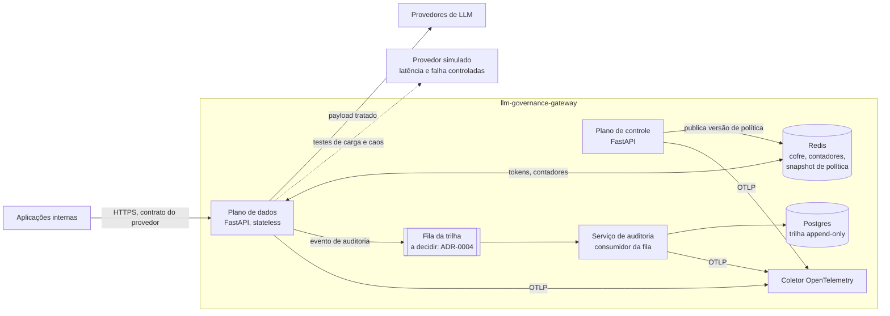
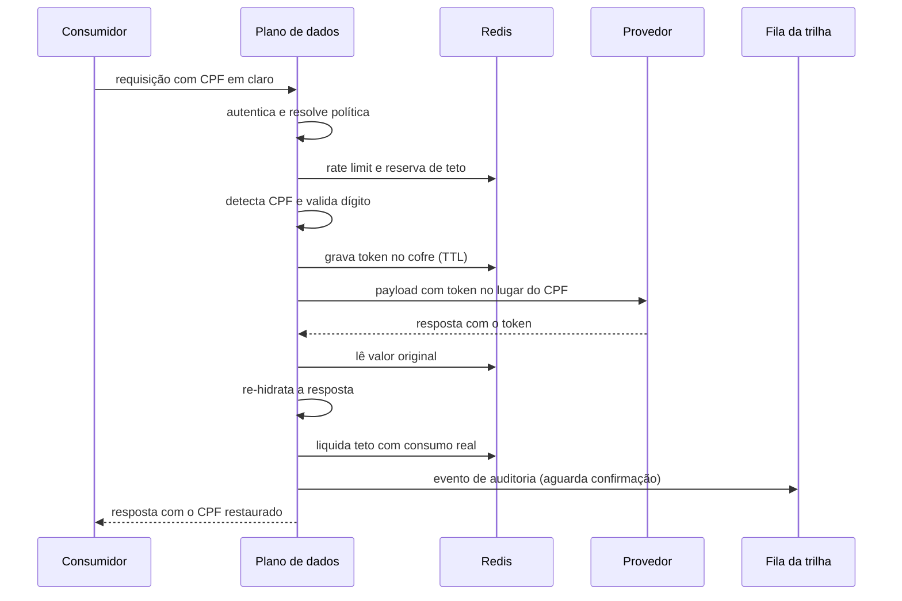

# llm-governance-gateway: Documento de Design de Software (SDD)

**Versão:** 0.1
**Data:** 2026-10-22
**Autor:** Eduardo Gonçalves, Arquiteto de Soluções Sênior
**Status do documento:** proposto, em revisão

> **Como ler este documento.** Cada seção declara o próprio estado. Uso cinco rótulos e
> nenhum outro:
>
> | Rótulo | Significado |
> |---|---|
> | **Aceito** | Decisão registrada em ADR ou requisito publicado em `docs/01-requisitos.md` |
> | **Proposto** | Minha proposta de design, ainda sem ADR. Pode mudar sem aviso |
> | **Lacuna** | Algo que os requisitos não definem e que muda o design |
> | **Implementado** | Existe código no repositório |
> | **Medido** | Existe resultado publicado em `benchmarks/` |
>
> Hoje nada neste projeto está implementado ou medido. O que existe é requisito, contexto e
> duas decisões aceitas.

---

## Sumário

1. [Introdução](#1-introdução)
2. [Contexto e problema](#2-contexto-e-problema)
3. [Requisitos: resumo e inconsistências](#3-requisitos-resumo-e-inconsistências)
4. [Visão arquitetural](#4-visão-arquitetural)
5. [Design por serviço](#5-design-por-serviço)
6. [Design de dados](#6-design-de-dados)
7. [Fluxos principais](#7-fluxos-principais)
8. [Aspectos transversais](#8-aspectos-transversais)
9. [Implantação: referência e alvo](#9-implantação-referência-e-alvo)
10. [Estratégia de verificação](#10-estratégia-de-verificação)
11. [Registro de decisões](#11-registro-de-decisões)
12. [Riscos e lacunas](#12-riscos-e-lacunas)
13. [Roteiro de construção](#13-roteiro-de-construção)

---

## 1. Introdução

### 1.1 Propósito

Este documento organiza, em um só lugar e em ordem hierárquica, como o gateway será
construído. Ele não substitui os documentos de origem. Ele os conecta e mostra o que ainda
falta decidir.

### 1.2 Precedência entre documentos

Em caso de conflito, vale a ordem abaixo. Se o SDD contradisser um documento acima dele,
o SDD está errado e deve ser corrigido.

1. `docs/01-requisitos.md`: o que o sistema precisa fazer e com quais números.
2. `docs/adr/`: decisões aceitas, com alternativas e consequências.
3. `docs/c4/`: diagramas em código.
4. Este SDD: design detalhado, propostas e lacunas.

### 1.3 Escopo

**Dentro (Aceito, `01-requisitos.md` §5 e §6):** proxy HTTP, política declarativa por
consumidor, detecção e pseudonimização de PII brasileira com re-hidratação, rate limit,
teto de gasto, trilha de auditoria append-only, fallback entre provedores com circuit
breaker, telemetria OpenTelemetry.

**Fora (Aceito, `01-requisitos.md` §4):** treinamento, RAG e base vetorial, avaliação
semântica de resposta, interface gráfica, cache semântico, multi-tenancy físico.

### 1.4 Dois artefatos distintos

| Artefato | O que é | Onde vive |
|---|---|---|
| **Arquitetura alvo** | Desenho de produção em AWS, documentado, não operado | `docs/`, `infra/` |
| **Implementação de referência** | Subconjunto executável em Docker Compose, instrumentado e medido | `src/`, `tests/`, `benchmarks/`, `docker-compose.yml` |

Toda afirmação deste documento indica a qual dos dois se refere quando a diferença
importa.

### 1.5 Glossário do domínio

Uso estes termos sempre com o mesmo sentido.

| Termo | Definição neste projeto |
|---|---|
| **Consumidor** | Aplicação interna identificada por identidade de serviço que chama o gateway |
| **Provedor** | Serviço externo de modelo de linguagem para onde a requisição é encaminhada |
| **Política** | Conjunto declarativo, versionado em YAML, que define o que o gateway faz para um consumidor e uma rota |
| **Plano de dados** | Serviço no caminho crítico da requisição |
| **Plano de controle** | Serviço que valida e distribui política |
| **Trilha** | Registro append-only de cada requisição, encadeado por hash |
| **Mascarar** | Substituir o valor de PII de forma irreversível antes da saída |
| **Pseudonimizar** | Substituir o valor de PII por token reversível, guardado no cofre |
| **Re-hidratar** | Restaurar, na resposta ao consumidor autorizado, o valor original de um token |
| **Cofre de tokens** | Armazenamento de curta duração que liga token a valor original |
| **Overhead** | Tempo acrescentado pelo gateway, excluído o tempo do provedor |
| **Fallback** | Encaminhamento para provedor alternativo quando o primário falha |

### 1.6 Referências

- [Requisitos](01-requisitos.md)
- [C4 Nível 1: Contexto](c4/01-contexto.md) e [workspace Structurizr](c4/workspace.dsl)
- [ADR-0001: Decomposição em três serviços](adr/0001-decomposicao-em-tres-servicos.md)
- [ADR-0002: Detecção de PII determinística](adr/0002-deteccao-de-pii-deterministica.md)

---

## 2. Contexto e problema

**Estado: Aceito** (`01-requisitos.md` §1 a §3).

**Em linguagem de negócio.** Uma instituição regulada quer usar modelos de linguagem sem
perder o controle sobre quatro coisas: qual dado de cliente saiu, quem perguntou, sob qual
regra e a que custo. Sem resposta auditável para essas quatro perguntas, o projeto não
passa pela segurança da informação nem pelo jurídico.

**Em linguagem técnica.** Um proxy de camada 7, no contrato de API do provedor, aplica uma
cadeia de políticas por consumidor e por rota, registra cada decisão em trilha append-only
e isola o consumidor da falha do provedor.

**Quem define os requisitos.** O C4 Nível 1 mostrou quatro públicos. O time de produto faz
a chamada. Auditoria e DPO, FinOps e SRE nunca tocam no sistema e consomem saída
assíncrona: trilha, custo e alerta. Essa assimetria é a origem da decomposição em três
serviços (ADR-0001).

---

## 3. Requisitos: resumo e inconsistências

### 3.1 Resumo

**Estado: Aceito.** O documento completo está em `01-requisitos.md`. Aqui fica só o mapa.

| Grupo | Requisitos | Componente responsável |
|---|---|---|
| Entrada e identidade | RF-01, RF-02, RNF-14 | Plano de dados: adaptador e resolvedor de política |
| Dado pessoal | RF-03, RF-04, RF-05, RNF-06, RNF-07 | Plano de dados: motor de PII e cofre |
| Consumo e custo | RF-06, RF-07, RNF-12 | Plano de dados: limitador e teto |
| Auditoria | RF-08, RF-12, RNF-08, RNF-09, RNF-10 | Serviço de auditoria |
| Resiliência | RF-09, RNF-04, RNF-05 | Plano de dados: roteador e circuit breaker |
| Operação | RF-10, RF-11, RNF-11, RNF-13 | Plano de controle e todos os serviços |
| Desempenho | RNF-01, RNF-02, RNF-03 | Plano de dados |

### 3.2 Inconsistências que identifiquei

**Estado: Lacuna.** Não corrijo requisito neste documento. Registro o conflito e a
decisão que ele exige.

| ID | Conflito | Consequência | Decisão necessária |
|---|---|---|---|
| INC-01 | RF-03 lista **nome próprio** como obrigatório. A ADR-0002 declara que nome próprio em texto corrido não é coberto no caminho síncrono | O critério de aceite de RF-03 não pode ser cumprido como está escrito | Reescrever RF-03 separando PII estruturada (obrigatória, síncrona) de PII não estruturada (fora do caminho crítico, conforme ADR-0002) |
| INC-02 | RF-12 prevê eliminação de dado do titular na trilha. RNF-10 diz que a trilha guarda só hash, nunca payload em claro | Não está definido qual dado do titular existe na trilha para ser eliminado | Definir o conteúdo da trilha ligado ao titular (ver ADR candidata 0005) |
| INC-03 | RNF-01 fixa overhead p95 de 50 ms sem perfil de carga | O mesmo gateway pode cumprir ou falhar o alvo dependendo do tamanho do payload | Declarar tamanho de payload e mistura de PII do teste de carga |
| INC-04 | RNF-05 fala em "falha do provedor primário" sem definir falha | Provedor lento e provedor fora do ar exigem tratamentos diferentes | Definir falha: erro de conexão, 5xx, tempo até o primeiro byte acima de limite |

---

## 4. Visão arquitetural

### 4.1 Princípios que governam o design

**Estado: Aceito**, derivados de requisitos e ADRs.

1. **Caminho crítico enxuto.** Só entra na cadeia síncrona o que precisa decidir antes da
   saída do dado. Todo o resto é assíncrono (RNF-01, ADR-0001).
2. **Determinismo onde há auditoria.** Decisão que precisa ser reproduzida não depende de
   modelo probabilístico (ADR-0002).
3. **Uma fronteira, um controle.** A única seta que sai da organização é a do gateway para
   o provedor. Mascaramento acontece ali e em nenhum outro lugar (C4 Nível 1).
4. **Falha do controle não derruba o tráfego.** O plano de dados opera com a última
   política válida se o plano de controle cair (RNF-04).
5. **Política é código.** Versionada, revisada, com autoria e histórico recuperável
   (RF-10, ADR-0002).

### 4.2 C4 Nível 1: Contexto

**Estado: Aceito.** Ver [c4/01-contexto.md](c4/01-contexto.md).

### 4.3 C4 Nível 2: Contêineres

**Estado: Proposto.** Este diagrama é minha proposta para a implementação de referência.
Ele vira artefato aceito quando for publicado em `docs/c4/02-conteineres.md` com as ADRs
candidatas 0004 e 0007 decididas.



**Por que cada contêiner existe:**

| Contêiner | Motivo | Requisitos |
|---|---|---|
| Plano de dados | Único componente no caminho crítico | RF-01 a RF-09, RNF-01 a RNF-03 |
| Plano de controle | Eixo de escala por mudança, não por requisição (ADR-0001) | RF-10, RNF-13 |
| Serviço de auditoria | Eixo de escala por retenção (ADR-0001) | RF-08, RNF-08 a RNF-10 |
| Redis | Estado compartilhado de baixa latência entre instâncias do plano de dados | RF-05 a RF-07, RNF-13 |
| Fila da trilha | Desacopla latência da requisição da durabilidade da trilha | RNF-01, RNF-09 |
| Postgres | Persistência durável e consultável da trilha | RF-08, RNF-10 |
| Coletor OpenTelemetry | Ponto único de exportação de traço e métrica | RF-11, RNF-11 |
| Provedor simulado | Sem ele não há como medir overhead isolado nem injetar falha | RNF-01, RNF-05 |

### 4.4 Fronteiras de confiança

**Estado: Aceito** quanto à fronteira externa, **Proposto** quanto às internas.

| Fronteira | O que atravessa | Controle |
|---|---|---|
| Organização para provedor | Payload já tratado pela política | Mascaramento e pseudonimização no plano de dados |
| Consumidor para gateway | Requisição com PII em claro | Autenticação por identidade de serviço (RF-02) |
| Plano de dados para Redis | Valor original de PII no cofre | Rede interna, TTL curto, sem persistência em disco (ADR-0006) |
| Plano de dados para fila | Evento de auditoria sem payload em claro | Apenas hash chaveado e metadados (RNF-10) |

---

## 5. Design por serviço

### 5.1 Plano de dados

**Estado: Proposto**, exceto onde indicado.

#### 5.1.1 Componentes internos

| Componente | Responsabilidade | Requisitos | Estado |
|---|---|---|---|
| Adaptador de protocolo | Recebe no contrato do provedor e normaliza para o formato interno | RF-01, RNF-14 | Proposto (ADR-0003) |
| Autenticador | Valida identidade de serviço do consumidor | RF-02 | Proposto (ADR-0011) |
| Resolvedor de política | Seleciona a política do consumidor e da rota a partir do snapshot em memória | RF-02, RF-10 | Proposto |
| Limitador | Janela deslizante por consumidor e rota | RF-06 | Aceito como abordagem (matriz §10 dos requisitos) |
| Teto de gasto | Reserva custo estimado antes e liquida custo real depois | RF-07 | Proposto (ADR-0008) |
| Motor de PII | Detecção por padrão estrutural e validação de dígito verificador | RF-03, RF-04 | Aceito (ADR-0002) |
| Cliente do cofre | Grava e lê tokens de pseudonimização | RF-05 | Proposto (ADR-0006) |
| Roteador | Escolhe provedor por prioridade, respeitando destinos permitidos pela política | RF-09 | Proposto (ADR-0010) |
| Circuit breaker | Um por provedor | RF-09, RNF-05 | Proposto (ADR-0010) |
| Emissor de auditoria | Publica o evento na fila com confirmação | RF-08, RNF-09 | Proposto (ADR-0004) |
| Telemetria | Traço por requisição com atributos de política e custo | RF-11, RNF-11 | Aceito como requisito; instrumentação desde o primeiro commit |

#### 5.1.2 Ordem da cadeia síncrona

**Estado: Proposto.** A ordem importa porque cada etapa que rejeita cedo poupa as
seguintes.

1. Início do traço e atribuição do identificador de correlação.
2. Autenticação do consumidor. Rejeita sem identidade válida.
3. Resolução de política no snapshot em memória. Nenhuma chamada de rede.
4. Rate limit. Rejeita antes de gastar processamento com PII.
5. Reserva de teto de gasto com custo estimado. Rejeita se o teto for ultrapassado.
6. Detecção de PII e aplicação da ação por tipo: mascarar, pseudonimizar, bloquear ou
   permitir com registro.
7. Gravação dos tokens no cofre.
8. Roteamento ao provedor com circuit breaker e fallback.
9. Re-hidratação da resposta.
10. Liquidação do teto com o consumo real informado pelo provedor.
11. Publicação do evento de auditoria com confirmação da fila.
12. Resposta ao consumidor.

O passo 11 está antes do passo 12 de propósito. A justificativa está na ADR candidata
0004: RPO zero para requisições concluídas exige que nenhuma resposta saia sem o evento
confirmado pela fila.

#### 5.1.3 Orçamento de latência por etapa

**Estado: Proposto.** São alvos internos que somam o RNF-01. Servem para saber, na
primeira medição, qual etapa estourou. Valores serão revistos após a medição de linha de
base.

| Etapa | Orçamento p95 |
|---|---|
| Framework, serialização e adaptador | 10 ms |
| Autenticação e resolução de política | 2 ms |
| Rate limit e reserva de teto (uma ida ao Redis em pipeline) | 5 ms |
| Detecção de PII e ação | 10 ms |
| Gravação no cofre | 3 ms |
| Re-hidratação | 5 ms |
| Publicação na fila com confirmação | 5 ms |
| Margem | 10 ms |
| **Total** | **50 ms** |

A detecção de PII depende do tamanho do payload. Esse orçamento só tem sentido depois de
resolvida a INC-03.

### 5.2 Plano de controle

**Estado: Proposto.**

- **Fonte da política:** arquivos YAML em `config/policies/`, versionados no Git.
- **Validação:** schema verificado no carregamento. Política inválida nunca é publicada
  (RF-10).
- **Distribuição:** o plano de controle publica uma versão nova. Cada instância do plano de
  dados troca o snapshot em memória de forma atômica (RNF-13).
- **Falha:** se o plano de controle cair, o plano de dados segue com o último snapshot
  válido e emite alerta (RNF-04).
- **Evidência:** o identificador da versão da política vai para a trilha em cada requisição.
  É o que permite responder qual política valia em uma data passada (ADR-0002).

A forma da distribuição (publicação em Redis, consulta periódica ou ambos) é a ADR
candidata 0007.

### 5.3 Serviço de auditoria

**Estado: Proposto.**

- Consome eventos da fila e grava em tabela append-only no Postgres.
- Encadeia cada registro ao anterior por hash, de modo que alteração ou remoção silenciosa
  quebre a cadeia.
- Expõe um contador de eventos recebidos para a reconciliação do RNF-08.
- Nunca recebe payload em claro (RNF-10).
- A eliminação seletiva do RF-12 fica documentada como arquitetura alvo, não implementada
  na v0.1 (`01-requisitos.md` §11).

---

## 6. Design de dados

### 6.1 Política

**Estado: Proposto.** O exemplo abaixo é um **modelo ilustrativo** do formato, não um
schema decidido.

```yaml
# MODELO ILUSTRATIVO - schema a definir na ADR-0007
version: "2026-10-22.1"
consumer: atendimento-backoffice
routes:
  - match: { path: /v1/chat/completions }
    pii:
      cpf: pseudonymize
      cnpj: pseudonymize
      card: block
      email: mask
      phone: mask
      cep: allow_with_log
    rate_limit: { requests: 60, window_seconds: 60 }
    budget: { monthly_brl: 500.00, on_exceed: block }
    providers:
      allowed: [provider-a, provider-b]   # destinos permitidos pela política
      priority: [provider-a, provider-b]
```

Um ponto que o formato precisa resolver: o fallback só pode escolher provedor que a
política do consumidor permite. Trocar de provedor pode trocar o país de processamento, e
isso afeta transferência internacional de dado (`01-requisitos.md` §7).

### 6.2 Registro de auditoria

**Estado: Aceito** quanto aos campos (RF-08), **Proposto** quanto ao formato.

| Campo | Origem |
|---|---|
| Identificador da requisição | Plano de dados |
| Identidade do consumidor | Autenticador |
| Timestamp | Plano de dados |
| Versão da política aplicada | Resolvedor |
| Versão das regras de PII | Motor de PII (ADR-0002) |
| Hash chaveado do payload | Emissor (ver ADR candidata 0005) |
| PII detectada, por tipo e quantidade | Motor de PII |
| Ação aplicada por tipo | Motor de PII |
| Provedor efetivo e se houve fallback | Roteador |
| Tokens consumidos e custo estimado | Teto de gasto |
| Hash do registro anterior | Serviço de auditoria |

**Risco técnico que identifiquei.** Hash simples, sem chave, de um payload curto com CPF
pode ser revertido por força bruta, porque o espaço de CPFs válidos é pequeno para
computação atual. Minha proposta é usar hash chaveado (HMAC) com chave fora do banco. A
decisão fica na ADR candidata 0005.

### 6.3 Cofre de tokens

**Estado: Proposto.**

- Chave: token opaco gerado pelo gateway. Valor: dado original.
- Escopo do token: limitado à requisição ou à conversa do consumidor, nunca global.
- TTL curto, sem persistência em disco.
- Comportamento quando o cofre falha: **a definir na ADR-0006.** As opções são devolver a
  resposta com o token sem re-hidratar ou falhar a requisição. Cada uma tem consequência
  diferente para o consumidor e para o RNF-04.

### 6.4 Contadores de consumo

**Estado: Proposto.**

- Rate limit: janela deslizante por consumidor e rota.
- Teto de gasto: reserva atômica do custo estimado antes da chamada, liquidação pelo
  consumo real depois. Requisições concorrentes podem ultrapassar o teto em no máximo o
  valor das reservas em curso. Esse limite de ultrapassagem precisa ser declarado (ADR-0008).

---

## 7. Fluxos principais

**Estado: Proposto.** Cada fluxo abaixo vira cenário de teste em `tests/`.

### 7.1 Requisição com pseudonimização e re-hidratação



### 7.2 Fluxos de exceção

| Fluxo | Gatilho | Comportamento esperado | Requisito |
|---|---|---|---|
| PII bloqueada | Política define `block` para o tipo detectado | Rejeita antes do provedor; evento de auditoria registra o bloqueio | RF-04 |
| Teto excedido | Reserva ultrapassa o teto | Rejeita antes do provedor; evento registra a rejeição | RF-07 |
| Rate limit | Janela cheia | Rejeita com indicação de nova tentativa | RF-06 |
| Fallback | Provedor primário em falha (INC-04) ou circuito aberto | Encaminha ao próximo provedor permitido em até 2 s | RF-09, RNF-05 |
| Plano de controle fora | Sem nova versão disponível | Segue com último snapshot válido e alerta | RNF-04 |
| Recarga de política | Nova versão publicada | Troca atômica do snapshot sem reinício | RNF-13 |

---

## 8. Aspectos transversais

### 8.1 Segurança e privacidade

**Estado: Aceito** quanto aos requisitos, **Proposto** quanto aos mecanismos.

- Minimização: só sai do perímetro o dado necessário à finalidade declarada na política.
- Payload em claro nunca é persistido (RNF-10).
- Chaves de provedor ficam no gateway, nunca no consumidor.
- Segredos: variáveis de ambiente na referência, Secrets Manager no alvo.
- Normativos setoriais específicos não foram verificados e não serão citados nominalmente
  antes de confirmação na fonte oficial (`01-requisitos.md` §7).

### 8.2 Observabilidade

**Estado: Proposto.** Atributos mínimos de cada traço, para cumprir o RNF-11:

`consumer.id`, `policy.version`, `pii.rules.version`, `pii.detected.count`,
`pii.action`, `provider.selected`, `provider.fallback`, `budget.reserved`,
`budget.settled`, `audit.enqueued`.

Métricas mínimas: overhead por etapa (§5.1.3), estado de cada circuit breaker, taxa de
rejeição por motivo, eventos publicados contra eventos gravados.

### 8.3 Resiliência

**Estado: Proposto.** Timeouts explícitos por provedor, circuit breaker por provedor,
fallback restrito aos destinos permitidos, plano de dados independente do plano de
controle em tempo de execução.

### 8.4 Custo

**Estado: Proposto.** O RNF-12 compara custo de infraestrutura do gateway com custo de
inferência intermediado. O cálculo será publicado aberto, com as premissas de volume e
preço, em `benchmarks/`.

---

## 9. Implantação: referência e alvo

**Estado:** referência **Proposto**; alvo **Aceito** como documentação (README).

| Elemento | Implementação de referência | Arquitetura alvo |
|---|---|---|
| Entrada | Porta exposta pelo Compose | ALB com WAF |
| Execução | Contêineres no Docker Compose | ECS Fargate em subnets privadas |
| Estado compartilhado | Redis em contêiner | ElastiCache |
| Fila da trilha | A decidir (ADR-0004) | SQS |
| Trilha | Postgres em contêiner | RDS |
| Segredos | Variáveis de ambiente | Secrets Manager |
| Identidade | A decidir (ADR-0011) | IdP corporativo via OIDC |
| Infraestrutura como código | Não se aplica | Terraform em `infra/` |

**Janela AWS (Aceito, `01-requisitos.md` §11):** provisionamento temporário só para
medição, destruído logo após a captura. Nunca declarado como produção.

---

## 10. Estratégia de verificação

**Estado: Aceito** quanto a alvos e métodos (`01-requisitos.md` §6 e §12), **Proposto**
quanto aos artefatos.

### 10.1 Regra de publicação

Todo RNF medido gera um arquivo em `benchmarks/` com data, ambiente, perfil de carga,
resultado e desvio em relação ao alvo. Desvio desfavorável é publicado igual ao
favorável.

### 10.2 Mapa de verificação

| RNF | Método | Pré-requisito | Artefato |
|---|---|---|---|
| RNF-01, RNF-02, RNF-03 | Teste de carga com provedor simulado | Provedor simulado; INC-03 resolvida | `benchmarks/rnf-01-03-*.md` |
| RNF-04 | Falha injetada no plano de controle | Snapshot em memória | `benchmarks/rnf-04-*.md` |
| RNF-05 | Queda do provedor primário sob carga | INC-04 resolvida | `benchmarks/rnf-05-*.md` |
| RNF-06, RNF-07 | Suíte contra dataset sintético | Dataset em `tests/pii_dataset/` | `benchmarks/rnf-06-07-*.md` |
| RNF-08, RNF-09 | Reconciliação contador contra trilha, com queda durante carga | ADR-0004 decidida | `benchmarks/rnf-08-09-*.md` |
| RNF-10 | Revisão de schema | Schema da trilha | `benchmarks/rnf-10-*.md` |
| RNF-11 | Inspeção de traço | Coletor ativo | Captura de traço |
| RNF-12 | Cálculo aberto | Medição de consumo | `benchmarks/rnf-12-*.md` |
| RNF-13 | Recarga a quente sob carga | Plano de controle | `benchmarks/rnf-13-*.md` |
| RNF-14 | Troca de provedor por configuração | ADR-0003 decidida | Teste automatizado |

### 10.3 Dataset sintético de PII

CPF, CNPJ e cartão gerados com dígito verificador válido e reconhecidamente fictícios,
mais casos negativos (sequências com estrutura certa e dígito errado) para medir falso
positivo. O escopo da medição do RNF-07 é PII **estruturada**, conforme ADR-0002, e esse
escopo é publicado junto do resultado.

---

## 11. Registro de decisões

### 11.1 Decisões aceitas

| ADR | Decisão | Data |
|---|---|---|
| [0001](adr/0001-decomposicao-em-tres-servicos.md) | Três serviços, separados por eixo de escala ou ciclo de vida | 2026-09 |
| [0002](adr/0002-deteccao-de-pii-deterministica.md) | Detecção de PII determinística no caminho crítico | 2026-09 |

### 11.2 Decisões candidatas

**Estado: Lacuna.** Cada linha é uma decisão que ainda não tomei. A ordem segue a
dependência de construção.

| ADR | Pergunta | Bloqueia | Requisitos |
|---|---|---|---|
| 0003 | Qual contrato de entrada adoto e como traduzo entre provedores? | Primeiro código do plano de dados | RF-01, RF-09, RNF-14 |
| 0011 | Como o consumidor se identifica na referência e no alvo? | Autenticador | RF-02 |
| 0006 | TTL, escopo e comportamento em falha do cofre de tokens | Pseudonimização | RF-05, RNF-04 |
| 0009 | Resposta em streaming entra na v0.1? Se entrar, como re-hidratar token partido entre fragmentos? | Re-hidratação | RF-01, RF-05 |
| 0007 | Formato do schema de política e mecanismo de distribuição | Plano de controle | RF-10, RNF-13, RNF-04 |
| 0008 | Reserva e liquidação do teto; limite de ultrapassagem aceito | Teto de gasto | RF-07 |
| 0004 | Qual fila na referência e em que ponto confirmo a entrega? | Trilha | RNF-08, RNF-09 |
| 0005 | Hash chaveado, encadeamento e relação com a eliminação do RF-12 | Trilha | RF-12, RNF-10 |
| 0010 | Definição de falha, timeouts e parâmetros do circuit breaker | Fallback | RF-09, RNF-05 |

A numeração é reservada, não cronológica. Uma ADR só recebe status de aceita quando o
arquivo existir em `docs/adr/` com contexto, alternativas efetivamente consideradas e
consequências.

---

## 12. Riscos e lacunas

| ID | Risco | Impacto | Mitigação |
|---|---|---|---|
| R-01 | Overhead estoura 50 ms por causa do tamanho do payload | RNF-01 não atingido | Medir linha de base cedo, com orçamento por etapa (§5.1.3) |
| R-02 | Streaming fora do escopo limita a utilidade para consumidores reais | Referência menos representativa | Decidir na ADR-0009 e declarar o limite no README |
| R-03 | Hash sem chave expõe PII por força bruta | Violação do RNF-10 na prática | ADR-0005 com hash chaveado |
| R-04 | Fallback envia dado para provedor em país não permitido | Exposição regulatória | Lista de destinos permitidos na política (§6.1) |
| R-05 | Falha do cofre devolve token ao consumidor | Resposta incorreta para o usuário final | Comportamento explícito na ADR-0006 e teste dedicado |
| R-06 | Publicação síncrona na fila cria dependência no caminho crítico | Fila fora do ar derruba requisições | Medir o custo e declarar o comportamento sob falha na ADR-0004 |
| R-07 | Escopo de construção maior que o tempo disponível | Medições não acontecem até a semana 12 | Cortar por prioridade (§13.2), nunca por silêncio |

Lacunas abertas herdadas dos requisitos (`01-requisitos.md` §13): normativos setoriais
vigentes e geração do dataset sintético.

---

## 13. Roteiro de construção

### 13.1 Estado em 2026-10-22

| Etapa | Estado |
|---|---|
| Engenharia de requisitos | Concluída |
| C4 Nível 1 | Concluído |
| ADR-0001 e ADR-0002 | Aceitas |
| SDD | Este documento, proposto |
| Plano de dados, PII, teto, trilha, fallback | Não iniciados |
| Medições | Não realizadas |

### 13.2 Sequência proposta

**Estado: Proposto.** Ordem definida por dependência técnica e pelo valor de cada medição.
Cada etapa termina com artefato no repositório.

| Etapa | Entrega | Critério de conclusão |
|---|---|---|
| E1 | Esqueleto do plano de dados: repasse ao provedor simulado, telemetria e Compose | Requisição atravessa o gateway e o traço aparece no coletor |
| E2 | Linha de base de overhead sem políticas | Primeiro arquivo em `benchmarks/` |
| E3 | Motor de PII e dataset sintético | RNF-07 medido e publicado |
| E4 | Pseudonimização, cofre e re-hidratação | Critério de aceite 1 da v0.1 atendido |
| E5 | Política em YAML, plano de controle e recarga a quente | RNF-13 verificado |
| E6 | Rate limit e teto de gasto | Testes de rejeição passando |
| E7 | Trilha: fila, serviço de auditoria, encadeamento | RNF-08 reconciliado |
| E8 | Fallback e circuit breaker | RNF-05 verificado com queda do primário |
| E9 | Medição completa e janela AWS | RNF-01 a RNF-03 e RNF-12 publicados |
| E10 | Retrospectiva | Tabela de alvos contra medido, com desvios |

**Corte por prioridade, se o tempo não couber:** E1 a E4 e E7 formam o núcleo que
sustenta a tese do projeto (PII na fronteira e trilha auditável). E5, E6 e E8 podem ser
reduzidos a versões mínimas declaradas. E9 pode medir só no Compose, declarando que a
janela AWS não aconteceu.

---

*Documento vivo. Mudança de design relevante gera ADR. Este SDD é atualizado para apontar
para ela.*
